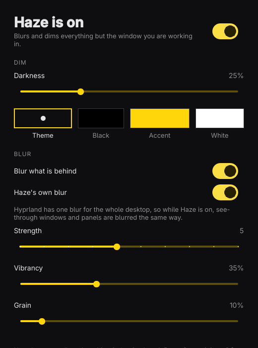

# Haze



Haze blurs and dims everything on your Omarchy desktop except the window you are working in, so the one in focus stands out and the rest falls back. The haze follows the focus from window to window, and you choose how dark it is, what color it is tinted, and how strong, vibrant, and grainy the blur is.

## Use

Open Haze from the app launcher (`Super + Space`). The haze is on as soon as it starts, and when you close the window Haze stays as an icon in the status bar's tray. Click the icon to turn the haze on or off; right-click it for its menu, which opens the window again and quits. Pressing `Q` in the window quits too.

| Key | Action |
| --- | --- |
| `Space` | Turn the haze on or off |
| `[` `]` | Dim less or more |
| `T` | Next tint |
| `B` | Blur, or only dim |
| `C` | Haze's own blur, or the desktop's |
| `-` `=` | Blur less or more |
| `?` | Show or hide the shortcuts |
| `Esc` | Close the window and keep the haze |
| `Q` | Quit |

From a terminal, a key binding, or your autostart:

```text
haze          Show the settings window
haze start    Start Haze without a window, as it was left
haze on       Turn the haze on, starting Haze if needed
haze off      Turn the haze off
haze toggle   Turn the haze on or off
haze quit     Turn the haze off and stop Haze
```

To have Haze from login, turn on *Start at login* in its window. To toggle it from the keyboard, bind a key to `haze toggle`.

## How it works

Haze puts one see-through layer over each screen, above the windows and clear of the bar, that takes no clicks or keys. A second one lies under the bar, so a see-through bar's background is hazed too while its clock and icons stay sharp. It tints the layer everywhere except over the focused window, and asks Hyprland to blur what is behind the layer wherever it is tinted. So the blur is Hyprland's own, live and on the GPU.

Good to know:

- Hyprland has one blur for the whole desktop. While the haze is on, Haze switches that blur on and, unless you pick the desktop's own, sets its strength, vibrancy, and grain, so other see-through windows and panels are blurred the same way. Turning the haze off, or quitting, gives the desktop its settings back. Haze never writes to your Hyprland or Omarchy config.
- A menu or popup that reaches outside the focused window is under the haze where it does, and so is the dock.
- A fullscreen window has no haze around it to show.
- Settings are kept in `~/.config/haze/settings.json`.

## Install

Haze is for [Omarchy](https://omarchy.org) and other Arch desktops running Hyprland. Until it is packaged, build it and install it for your user:

```bash
sudo pacman -S --needed base-devel cmake qt6-base qt6-declarative qt6-svg qt6-wayland layer-shell-qt
git clone https://github.com/nielsandersen/haze && cd haze
bin/build && cmake --install build --prefix ~/.local
```

That puts Haze in the app launcher. `xargs rm < build/install_manifest.txt` removes it again.

## Build

```bash
bin/build                                 # builds build/haze
bin/test                                  # builds, then runs the tests offscreen
cmake --install build --prefix ~/.local   # puts Haze in the app launcher
```

It needs Qt 6 (base, declarative, svg, wayland), `layer-shell-qt`, and a Hyprland that is configured in Lua, which is how Haze hands it the blur.

## License

MIT. The theme, translator, build, and test scaffolding come from the Omarchy apps by David Heinemeier Hansson.
